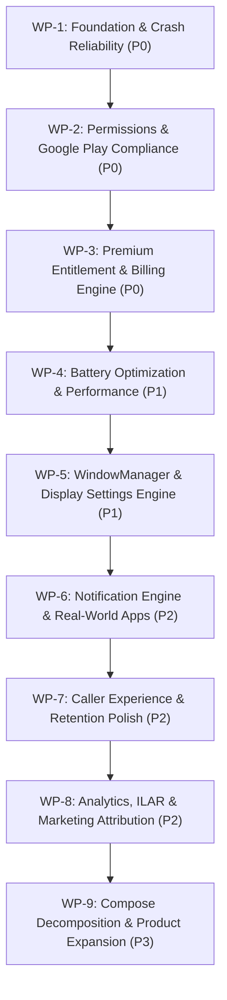

# Aurora Dynamic Island — Prioritized Implementation Roadmap
**Structured Engineering Work Packages for Phased Implementation Prompts**

**Document Version:** 2.0.0 (Master Edition)  
**Target Package:** `ai.emots.kishan_dynamic`  
**Purpose:** Actionable, dependency-aware execution plan designed specifically for consumption by ChatGPT or an engineering sprint team to generate individual implementation prompts.  
**Strict Mandate:** This document defines the roadmap only. Do not execute code changes during the audit phase.

---

## 1. Roadmap Architecture & Dependency Graph

---

## 2. Work Package Specifications

### Work Package 1: Foundation & Crash Reliability (P0)
- **Primary Objective:** Eliminate main-thread ANR bottlenecks and resolve cross-dispatcher concurrency races in core state management.
- **Estimated Effort:** 5 Hours (M)
- **Dependencies:** None (Execute First)
- **Target Files:**
  - `app/src/main/java/ai/emots/kishan_dynamic/service/IslandNotificationListener.kt`
  - `app/src/main/java/ai/emots/kishan_dynamic/service/IslandStateManager.kt`
- **Concrete Tasks:**
  1. Refactor `IslandNotificationListener.saveBitmapToCache`:
     - Offload `Bitmap.compress(PNG)` and `directory.listFiles()` file cleanup from the Main listener thread to `Dispatchers.IO`.
     - Implement an in-memory `LruCache<String, Bitmap>` (capacity = 30 bitmaps) to avoid repeated disk reads during notification redraws.
  2. Confine all state modifications in `IslandStateManager`:
     - Enforce `Dispatchers.Main.immediate` or a single-threaded mutex across `activeLiveActivities`, `notificationDeadlines`, and `dismissTimerJob`.
     - Update all calling receivers (`TelephonyStateReceiver`, `BatteryStateReceiver`) to switch to `Dispatchers.Main` before invoking state mutations.
- **Acceptance Criteria:**
  - Pushing 25 simultaneous notifications generates zero StrictMode disk read/write violations on the Main thread.
  - Concurrent incoming calls, battery charging events, and notification arrivals produce zero `ConcurrentModificationException` crashes.

---

### Work Package 2: Permissions & Google Play Compliance (P0)
- **Primary Objective:** Prune unused high-risk permissions and remove over-privileged accessibility service declarations to eliminate Google Play Store rejection risks.
- **Estimated Effort:** 2 Hours (S)
- **Dependencies:** None (Execute in parallel with WP-1)
- **Target Files:**
  - `app/src/main/AndroidManifest.xml`
  - `app/src/main/res/xml/accessibility_service_config.xml`
- **Concrete Tasks:**
  1. Prune unused sensitive permissions from `AndroidManifest.xml`:
     - Remove `<uses-permission android:name="android.permission.CAMERA" />` (system camera is launched via Intent; requires zero permissions).
     - Remove `<uses-permission android:name="android.permission.ACCESS_FINE_LOCATION" />` and `ACCESS_COARSE_LOCATION` (location coordinates are never read).
  2. Harden `accessibility_service_config.xml`:
     - Set `android:canPerformGestures="false"` (search confirms `dispatchGesture` is never called).
     - Set `android:canRetrieveWindowContent="false"` (app only checks window bounds).
     - Remove `typeWindowContentChanged` from `android:accessibilityEventTypes` (drops high-frequency text change callbacks).
- **Acceptance Criteria:**
  - `aapt dump permissions` on release APK contains zero camera or location permission strings.
  - Accessibility Service passes Google Play automated declaration scanning without flagging for keylogging/screen-scraping audits.

---

### Work Package 3: Premium Entitlement & Billing Engine (P0)
- **Primary Objective:** Resolve the catastrophic lifetime entitlement leak on weekly purchases, correct inverted feature gating, and restructure non-cannibalizing pricing.
- **Estimated Effort:** 4 Hours (M)
- **Dependencies:** WP-1
- **Target Files:**
  - `app/src/main/java/ai/emots/kishan_dynamic/data/premium/PlayBillingPremiumAccessGateway.kt`
  - `app/src/main/java/ai/emots/kishan_dynamic/data/premium/EntitlementManager.kt`
  - `app/src/main/java/ai/emots/kishan_dynamic/data/premium/PremiumFeaturePolicy.kt`
  - `app/src/main/java/ai/emots/kishan_dynamic/data/premium/PremiumBillingCatalog.kt`
  - `app/src/main/java/ai/emots/kishan_dynamic/ui/screens/PremiumScreen.kt`
- **Concrete Tasks:**
  1. Fix `PlayBillingPremiumAccessGateway.persistEntitlement`:
     - Extract `productId = purchase.products.first()`.
     - Compute accurate `expiresAt` timestamp: Weekly = `now + 7 days`, Monthly = `now + 30 days`, Yearly = `now + 365 days`.
     - Pass `planId` and `expiresAt` into `preferences.setProEntitlement(source = productId, expiresAt = expiresAt)`.
  2. Fix `EntitlementManager.reconcileEntitlement`:
     - Ensure `isLifetime` is only granted when `planId?.contains("lifetime", ignoreCase = true) == true`.
     - Enforce expiration when `expiresAtMillis != null && expiresAtMillis < now`.
  3. Correct `PremiumFeaturePolicy.callSummaryEnabled`:
     - Change line 39 from `!isProActive || requested` to `isProActive && requested`.
  4. Restructure Pricing Matrix:
     - India: Weekly ₹29, Monthly ₹49, Yearly ₹199 (Save 66%), Lifetime ₹499.
     - Tier-1: Weekly $0.99, Monthly $1.99, Yearly $9.99, Lifetime $29.99.
- **Acceptance Criteria:**
  - Automated tests in `EntitlementManagerTest` verify weekly purchases expire after 7 days and revert to Free tier.
  - Lifetime plan is anchored at 2.5x annual price, protecting recurring annual subscription revenue.

---

### Work Package 4: Battery Optimization & Performance (P1)
- **Primary Objective:** Eliminate continuous 1.5s Bluetooth polling, drop 24/7 Wi-Fi multicast scan locks, and allow host devices to enter CPU deep sleep.
- **Estimated Effort:** 4 Hours (M)
- **Dependencies:** WP-1
- **Target Files:**
  - `app/src/main/java/ai/emots/kishan_dynamic/service/MediaRouteActivityMonitor.kt`
  - `app/src/main/java/ai/emots/kishan_dynamic/service/BluetoothAccessoryMonitor.kt`
  - `app/src/main/java/ai/emots/kishan_dynamic/service/AudioVolumeObserver.kt`
- **Concrete Tasks:**
  1. In `MediaRouteActivityMonitor.kt`:
     - Remove `MediaRouter.CALLBACK_FLAG_PERFORM_ACTIVE_SCAN`. Scan passively or only when screen mirroring settings are open.
  2. In `BluetoothAccessoryMonitor.kt`:
     - Remove `1500L` polling loop in `monitorJob`.
     - Register dynamic broadcast receiver for `BluetoothDevice.ACTION_ACL_CONNECTED` and `ACTION_ACL_DISCONNECTED`.
  3. In `AudioVolumeObserver.kt`:
     - Listen to `"android.media.VOLUME_CHANGED_ACTION"` and `"android.media.RINGER_MODE_CHANGED"` instead of observing root `Settings.System.CONTENT_URI`.
     - Fix line 61: check `preferences.showRingerModeIndicator.first()` instead of `showVolumeIndicator.first()`.
- **Acceptance Criteria:**
  - Battery Historian profiling confirms zero active Wi-Fi scan locks while Aurora is running in the background.
  - Toggling ringer switch (Silent -> Ring) reliably shows Ringer HUD even when Volume HUD is disabled.

---

### Work Package 5: WindowManager & Display Settings Engine (P1)
- **Primary Objective:** Prevent status bar touch occlusion when overlay is disabled, and connect missing display customization settings to the rendering engine.
- **Estimated Effort:** 5 Hours (M)
- **Dependencies:** WP-1, WP-4
- **Target Files:**
  - `app/src/main/java/ai/emots/kishan_dynamic/service/IslandOverlayService.kt`
  - `app/src/main/java/ai/emots/kishan_dynamic/ui/components/DynamicIslandPill.kt`
  - `app/src/main/java/ai/emots/kishan_dynamic/ui/screens/DisplaySettingsScreen.kt`
  - `app/src/main/java/ai/emots/kishan_dynamic/service/IslandStateManager.kt`
- **Concrete Tasks:**
  1. Fix WindowManager "Always on Top" leak in `IslandOverlayService.kt`:
     - Inspect `policy.alwaysOnTop` in `shouldAttach` and `updateLayoutParams()`.
     - When `alwaysOnTop` is false, add `FLAG_NOT_TOUCHABLE` and remove view when hidden.
  2. Sync WindowManager width with Compose animated width:
     - Avoid setting WindowManager width immediately to 370dp while Compose animates from 126dp.
  3. Connect Disconnected Display Settings:
     - Wire `idleAutoHideEnabled` and `idleAutoHideTimeoutSeconds` into `IslandStateManager` to trigger `IslandState.Hidden`.
     - Wire `notchFlatTop` into `DynamicIslandPill.kt:584` to flatten top corners (`topStart = 0.dp`, `topEnd = 0.dp`).
     - Wire `notchBackgroundArgb` and `notchForegroundArgb` into `DynamicIslandPill.kt` background and text styles.
- **Acceptance Criteria:**
  - Status bar clock and notifications in third-party apps can be tapped without obstruction when Always on Top is off.
  - Island cleanly auto-hides after configured idle timeout.
  - Monobrow and custom RGB colors reflect immediately on the hardware notch.

---

### Work Package 6: Notification Engine & Real-World Apps (P2)
- **Primary Objective:** Elevate messaging app compatibility for WhatsApp, Telegram, and regional UPI/banking notifications, and fix sticky media playback.
- **Estimated Effort:** 5 Hours (M)
- **Dependencies:** WP-1, WP-5
- **Target Files:**
  - `app/src/main/java/ai/emots/kishan_dynamic/service/IslandNotificationListener.kt`
  - `app/src/main/java/ai/emots/kishan_dynamic/data/notification/NotificationContentResolver.kt`
  - `app/src/main/java/ai/emots/kishan_dynamic/data/notification/NotificationPresentationPolicy.kt`
  - `app/src/main/java/ai/emots/kishan_dynamic/service/IslandStateManager.kt`
- **Concrete Tasks:**
  1. Implement `Notification.MessagingStyle` extraction:
     - Parse `extras.getParcelableArray(Notification.EXTRA_MESSAGES)` to extract author names and message stacks for WhatsApp and Telegram group chats.
  2. Harden sensitive content regex in `NotificationPresentationPolicy.kt:21`:
     - Add Hindi/Hinglish banking keywords (`otp`, `jama`, `kate`, `paise`, `bheje`, `khate`), currency symbols (`₹`), and numeric OTP patterns.
  3. Fix Paused Media Stickiness in `IslandStateManager.kt:453`:
     - Add an 8-second auto-dismiss timeout when media is paused (`isPlaying == false`), returning the island to `Idle`.
  4. Fix media classification blindspot in `IslandNotificationListener.kt:223`:
     - Check `EXTRA_MEDIA_SESSION` and `MediaStyle` template string alongside `CATEGORY_TRANSPORT`.
- **Acceptance Criteria:**
  - WhatsApp group chat alerts display specific author names rather than just the group title.
  - Hindi banking SMS alerts have sensitive amounts masked on the lockscreen.
  - Paused Spotify playback vanishes from the notch after 8 seconds.

---

### Work Package 7: Caller Experience & Retention Polish (P2)
- **Primary Objective:** Fix manifest receiver state loss, decouple call summary with rich notification fallback, and implement missed call recovery chips.
- **Estimated Effort:** 5 Hours (M)
- **Dependencies:** WP-1, WP-3
- **Target Files:**
  - `app/src/main/java/ai/emots/kishan_dynamic/service/TelephonyStateReceiver.kt`
  - `app/src/main/java/ai/emots/kishan_dynamic/ui/dialogs/CallSummaryDialog.kt`
  - `app/src/main/java/ai/emots/kishan_dynamic/ui/dialogs/BatteryOptimizationDialog.kt`
  - `app/src/main/java/ai/emots/kishan_dynamic/service/IslandNotificationListener.kt`
- **Concrete Tasks:**
  1. Fix `TelephonyStateReceiver.kt`:
     - Create a persistent singleton/companion session holder (`ActiveCallSessionHolder`) to retain caller identity, start timestamp, and hook status across manifest receiver invocations.
     - Wrap `onReceive()` in `val pendingResult = goAsync()` and ensure `pendingResult.finish()` is called in `finally`.
  2. Decouple Call Summary:
     - Implement a rich `CallStyle` high-priority system notification dispatched on `EXTRA_STATE_IDLE` with quick redial and WhatsApp shortcuts as a fallback when the overlay is dismissed or inactive.
  3. Missed Call Alerts:
     - When a missed call notification is detected by `IslandNotificationListener`, post an `IslandState.MissedCallAlert` with 1-tap "Call Back" and "Quick SMS" action chips.
  4. OEM Battery Setup Wizard:
     - In `BatteryOptimizationDialog.kt`, detect device manufacturer (`Build.MANUFACTURER`) and provide custom instructions for Xiaomi (MIUI/HyperOS), Samsung (One UI), and Oppo/Realme (ColorOS).
- **Acceptance Criteria:**
  - Completed calls surface follow-up actions even if overlay is not active.
  - Missed calls generate actionable notch alerts.
  - OEM setup guides direct users to the exact battery management settings screen.

---

### Work Package 8: Analytics, ILAR & Marketing Attribution (P2)
- **Primary Objective:** Unify fragmented analytics sinks, populate mandatory GA4 user properties, and expose UMP privacy options for GDPR compliance.
- **Estimated Effort:** 4 Hours (M)
- **Dependencies:** WP-2, WP-3
- **Target Files:**
  - `app/src/main/java/ai/emots/kishan_dynamic/data/release/RemoteReleaseRuntimeConfigProvider.kt`
  - `app/src/main/java/ai/emots/kishan_dynamic/data/premium/AdConsentGateway.kt`
  - `app/src/main/java/ai/emots/kishan_dynamic/data/premium/AdSurfacePolicy.kt`
  - `app/src/main/java/ai/emots/kishan_dynamic/data/analytics/FirebaseAnalyticsTracker.kt`
  - `app/src/main/java/ai/emots/kishan_dynamic/ui/screens/SettingsVaultScreen.kt`
- **Concrete Tasks:**
  1. Harden `ReleaseRuntimeConfigDecoder`:
     - Add decoder aliases for `premiumFeatures`, `isTrustSectionVisible`, and `rewardAdFreeDays` matching production Remote Config payloads.
  2. Implement UMP Privacy Options Form in `AdConsentGateway`:
     - Expose `showPrivacyOptions(activity)` and add a "Privacy & Ad Consent" button in `SettingsVaultScreen` when `privacyOptionsRequired == true`.
  3. Align `AdSurfacePolicy`:
     - Update `shouldShow` to check `!isAdFree` rather than `!isProActive` so in-app ads display during 7-day install trials.
  4. Unify Analytics:
     - Delete dead file `FirebaseEventManager.kt`.
     - Route ad gateway lifecycle events into `AnalyticsTracker`.
     - Populate mandatory GA4 user properties (`is_pro`, `app_theme`, `notch_preset`, `app_language`).
- **Acceptance Criteria:**
  - Remote Config updates to features and trust sections take effect without fallback.
  - EEA users can reopen the UMP consent form from Settings Vault.
  - GA4 DebugView displays populated user properties.

---

### Work Package 9: Compose Decomposition & Product Expansion (P3)
- **Primary Objective:** Decompose monolithic composable files, optimize layout-phase animations, and implement user-requested customization features.
- **Estimated Effort:** 7 Hours (L)
- **Dependencies:** WP-5, WP-6
- **Target Files:**
  - `app/src/main/java/ai/emots/kishan_dynamic/ui/components/DynamicIslandPill.kt`
  - `app/src/main/java/ai/emots/kishan_dynamic/ui/components/NotificationIsland.kt`
  - `app/src/main/java/ai/emots/kishan_dynamic/ui/components/DynamicNotchParent.kt`
  - `app/src/main/java/ai/emots/kishan_dynamic/ui/NotificationReplyActivity.kt`
- **Concrete Tasks:**
  1. Decompose `DynamicIslandPill.kt` (5,636 lines):
     - Extract call components into `ui/components/island/CallIslandContent.kt`.
     - Extract media controls into `ui/components/island/MediaIslandContent.kt`.
     - Extract timer/stopwatch into `ui/components/island/TimerIslandContent.kt`.
  2. Optimize Compose Recompositions:
     - Migrate `animatedWidth` and `animatedHeight` reads from composition phase to layout phase using `Modifier.layout`.
     - Migrate corner morphing to draw phase via `graphicsLayer`.
  3. Unify duplicate state mapping between `IslandOverlayService.kt:769` and `DynamicNotchParent.kt:62`.
  4. Prune unused `NotificationReplyActivity.kt` or hook it up to notification reply actions.
- **Acceptance Criteria:**
  - Compose compiler stability report confirms zero unstable recomposition loops in island layout.
  - Clean separation of concerns with sub-500 line composables.
