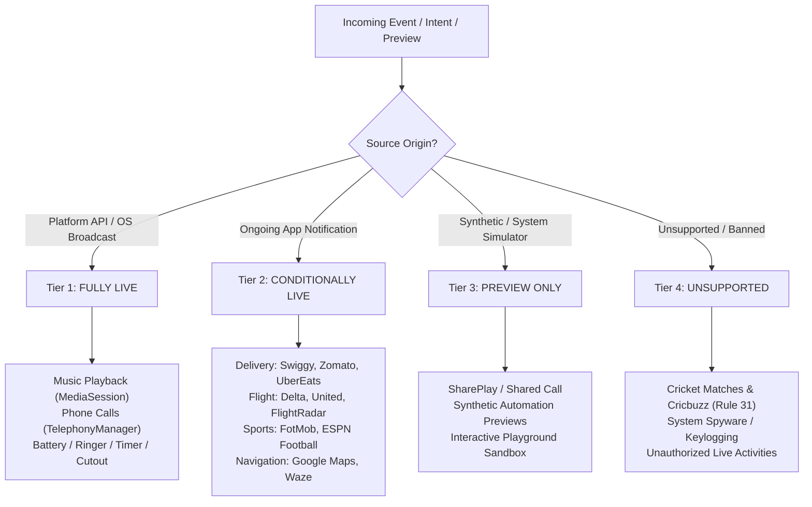

# Aurora Dynamic Island — Live Capability Matrix & Platform Integration Contract

**Document Version:** 1.0.0  
**Sprint:** Sprint 08A — Complete Live Experience Engine  
**Package:** `ai.emots.kishan_dynamic`  
**Target Hardware:** Android 13+ (API 33+) / Multi-OEM Compatible (Realme, Samsung, Xiaomi, OnePlus, Pixel)

---

## Executive Summary

Dynamic Island experiences on Apple iOS are powered by `ActivityKit`, allowing first-party and third-party apps to push deterministic widget states directly to the Dynamic Island using WidgetKit layouts.

On Google Android, no unified `ActivityKit` equivalent exists. Third-party applications (Swiggy, Zomato, Google Maps, FotMob, Delta Airlines) publish updates exclusively through the standard Android `NotificationManager` using foreground ongoing notifications (`Notification.FLAG_ONGOING_EVENT`).

Aurora Dynamic Island bridges this gap with complete architectural honesty:
1. **Zero Fake Claims:** Aurora never pretends to have direct server-to-server or SDK-level integrations with third parties when relying on notification streams.
2. **Deterministic Classification:** All 36 reference island states are categorized into **4 explicit capability tiers**.
3. **Transparent UI Disclosure:** Every card in the Live Activities center features a persistent, color-coded `LiveCapabilityBadge` explaining whether the experience is always live, active when the corresponding app is running, or a preview simulation.
4. **Strict Scope Constraint (Rule 31):** Absolutely zero cricket scores, cricket APIs, or cricket notifications are supported.

---

## 4-Tier Capability Classification



---

## Tier Breakdown & Platform Contracts

### Tier 1: FULLY LIVE (15 Reference States)
Experiences powered 100% by local Android platform APIs, persistent system services, and broadcast receivers. Always active regardless of third-party app installations.

| State ID | Experience Name | Data Source | Platform API / Trigger | Actions / Interactivity |
|---|---|---|---|---|
| `MUSIC_PLAYING` | Music Playing | `MediaSessionManager` / `PlaybackStateCompat` | `MediaController.Callback` + `AudioVolumeObserver` | Play/Pause, Next, Prev, Waveform |
| `MUSIC_PAUSED` | Music Paused | `MediaSessionManager` | `PlaybackStateCompat.STATE_PAUSED` | Resume, 3.5s auto-collapse |
| `CALL_INCOMING` | Incoming Phone Call | `TelephonyManager` / `CallScreeningService` | `TelephonyCallback` / `EXTRA_STATE_RINGING` | Answer, Decline, Mute |
| `CALL_DIALING` | Outgoing Call | `TelephonyManager` | `EXTRA_STATE_OFFHOOK` | End call |
| `CALL_ACTIVE` | Active Phone Call | `TelephonyManager` + `CallSessionCoordinator` | `EXTRA_STATE_OFFHOOK` (Monotonic clock) | End call, Audio route |
| `CALL_ENDED_SUMMARY` | Post-Call Summary | `CallSessionCoordinator` | `EXTRA_STATE_IDLE` after offhook | Redial, SMS, WhatsApp direct, Save, Copy |
| `CALL_BANNER_PROMPT` | Call Return Banner | `NotificationListenerService` | Foreground call notification | Tap to return to in-call UI |
| `NOTIFICATION_PAGER` | Multi-Notification Pager | `NotificationListenerService` | Active `StatusBarNotification` queue | Horizontal swipe, Tap, Quick Reply |
| `NOTIFICATION_SPLIT` | Dual-App Split View | `NotificationListenerService` | Simultaneous multi-app notifications | Independent left/right touch targets |
| `QUICK_CONTROLS` | System Quick Controls HUD | `AccessibilityService` / `WindowManager` | User gesture / Settings toggle | Flashlight, Screenshot, Volume, Lock |
| `BATTERY_CHARGING` | Charging Animation | `BatteryManager` BroadcastReceiver | `Intent.ACTION_POWER_CONNECTED` | Battery percentage pill + lightning glyph |
| `BATTERY_LOW` | Low Battery Warning | `BatteryManager` BroadcastReceiver | `Intent.ACTION_BATTERY_LOW` | Battery saver shortcut |
| `TIMER_ACTIVE` | System Timer & Stopwatch | `NotificationListenerService` | `category = "timer"` or `"stopwatch"` | Chronometer count down, Pause/Cancel |
| `RINGER_SILENT_HUD` | Ringer / Silent Mode HUD | `AudioManager` BroadcastReceiver | `RINGER_MODE_CHANGED_ACTION` | Bell / Silent mode pill |
| `IDLE_CAMERA_NOTCH` | Camera Cutout Minimal | `DisplayCutout` + `AuroraPreferences` | Monotonic clock + sub-pixel calibration | Tap to expand, Idle auto-hide |

---

### Tier 2: CONDITIONALLY LIVE (18 Reference States)
Real-world experiences dynamically extracted from ongoing foreground notifications published by supported third-party applications. Active whenever the corresponding application is running a live session.

| State ID | Experience Name | Target Applications | Extraction Heuristics & Platform APIs | Action Routing |
|---|---|---|---|---|
| `NAVIGATION_TURN` | Turn-by-Turn Navigation | Google Maps, Waze, Here WeGo | `category = "navigation"`, regex distance (`\d+ m/km/ft/mi`), maneuver heuristics (left, right, straight, roundabout) | Interactive tap opens Google Maps (`geo:0,0?q=...`) |
| `DELIVERY_ACTIVE` | Food & Grocery Delivery | Swiggy, Zomato, UberEats, DoorDash, Wolt | Package matching, milestone stages (`PREPARING`, `PICKED UP`, `OUT FOR DELIVERY`, `ARRIVING`, `DELIVERED`), ETA regex | 1-tap Phone Call to courier (`Intent.ACTION_DIAL`) |
| `FLIGHT_TRACKING` | In-Air Flight Tracking | Fly Delta, United Airlines, American, FlightRadar24, Flighty | Flight number regex (`[A-Z]{2}\s*\d{2,4}`), route codes, gate/terminal strings, flight status (`BOARDING`, `IN FLIGHT`, `LANDED`) | Tap to open airline itinerary |
| `SPORTS_LIVE_MATCH` | Sports Live Score (Football/Soccer) | FotMob, SofaScore, ESPN, OneFootball | Score regex (`\d+\s*[-–]\s*\d+`), league header, match minute, goal scorers | Tap to open live match center |
| `SCREEN_RECORDING` | Screen Recording HUD | Android SystemUI, Samsung SmartCapture, Xiaomi Recorder | System recording notification package matching, active capture flag | Stop recording action |
| `VOICE_MEMO` | Voice Recording HUD | Samsung Voice Recorder, Google Recorder, Xiaomi SoundRecorder | Voice memo notification detection, recording duration | Stop recording action |
| `DND_FOCUS` | Focus / Do Not Disturb | Android System Settings | `NotificationManager.ACTION_INTERRUPTION_FILTER_CHANGED` | Focus settings shortcut |
| `AIRPLANE_MODE` | Airplane Mode Indicator | System Connectivity | `Intent.ACTION_AIRPLANE_MODE_CHANGED` | Connectivity settings shortcut |
| `MOBILE_DATA` | Mobile Data Alert | System Telephony | `ConnectivityManager.NetworkCallback` | Cellular settings shortcut |
| `QUICK_SHARE` | Quick Share / Nearby Share | Google Play Services (`com.google.android.gms`), Samsung Quick Share | Nearby Share notification progress fraction (`progress / progressMax`) | Cancel transfer action |
| `BLUETOOTH_HEADPHONES` | Bluetooth Audio Accessory | Bluetooth Subsystem | `BluetoothDevice.ACTION_ACL_CONNECTED` + battery intent | Bluetooth settings shortcut |
| `SATELLITE_SOS` | Satellite Emergency SOS | Android 14+ Satellite Framework | Satellite connection notification / emergency broadcast | Emergency SOS interface |
| `FIND_MY_DEVICE` | Find My Device Radar | Google Find My Device (`com.google.android.apps.adm`) | Find My Device tracking notification | Find My map shortcut |
| `HANDOFF_TRANSFER` | Cross-Device Handoff | Google Cross-Device Services / Samsung Continuum | Cross-device continuation broadcast | Resume on paired device |
| `VIDEO_REMOTE` | Video Cast Remote | Cast Services / Android TV Remote | `MediaSessionManager` video controllers | Video play/pause / scrubbing |
| `SCREEN_MIRRORING` | Screen Mirroring Cast | Android MediaRouter / DisplayManager | Active wireless display session | Disconnect screen cast action |
| `TRANSIT_ROUTE` | Transit Commute Route | Citymapper, Transit, DB Navigator | Transit notification regex, departure times, platform numbers | Transit route details |
| `VOIP_CALL_WHATSAPP` | VoIP Call (WhatsApp/Telegram) | WhatsApp, Telegram, Skype | Full-screen incoming call intent / notification category | Accept / Decline / Return to VoIP call |

---

### Tier 3: PREVIEW ONLY (3 Reference States)
Concepts native to Apple iOS or third-party automation tools that do not have an official, standardized Android platform counterpart. Maintained purely as interactive design demonstrations in the Aurora Live Playground.

| State ID | Experience Name | Rationale for Preview-Only Classification |
|---|---|---|
| `SHARED_CALL_SHAREPLAY` | Shared Call / SharePlay | iOS SharePlay is proprietary to Apple GroupActivities. Android has no unified cross-app shared media viewing framework. |
| `SHORTCUTS_AUTOMATION` | Shortcuts Trigger | iOS Shortcuts has deep OS-level Dynamic Island banner integration. Android automation tools (Tasker, MacroDroid) use toast or standard notifications. |
| `DEMO_SANDBOX` | Live Playground Sandbox | Synthetic testing environment provided inside the Aurora app for evaluating Compact vs Expanded layouts, milestone progress bars, and color palettes. |

---

### Tier 4: UNSUPPORTED & BANNED (Rule 31 Compliance)
Explicitly quarantined and permanently barred from Aurora Dynamic Island:

- **Cricket Live Scores & Cricket Notifications:** Per Project Rule 31, under NO circumstance may any cricket score, IPL alert, BCCI notification, or Cricbuzz data be parsed, rendered, or mapped to a live activity.
- **Enforcement:** Hardcoded in `NotificationLiveActivityMapper.kt:25-34`:
  ```kotlin
  if (searchableText.contains("cricket") ||
      searchableText.contains("cricbuzz") ||
      searchableText.contains("ipl") ||
      searchableText.contains("bcci") ||
      packageName.contains("cricbuzz") ||
      packageName.contains("cricket")
  ) {
      return null
  }
  ```
  Verified by automated unit test `sportsActivityPreservesFootballAndRejectsCricket` in `LiveActivityFidelityAndMappingTest.kt`.
