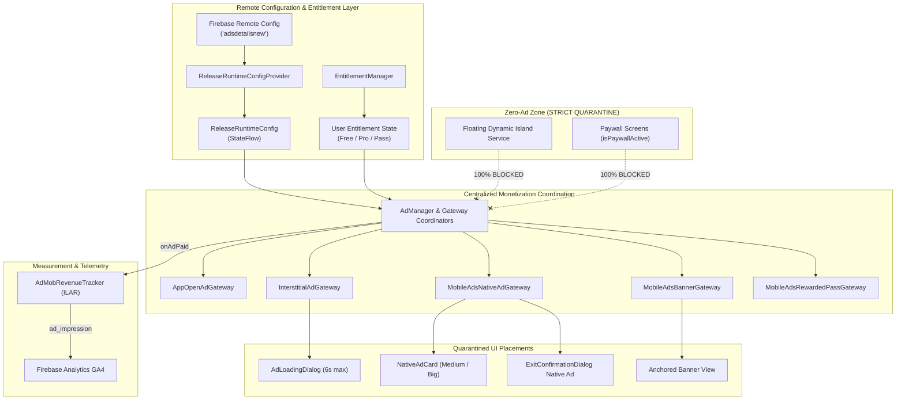

# Aurora Dynamic Island — Google Mobile Ads (AdMob Next-Gen) Architecture

**Version:** 2.0.0  
**Effective Date:** 17 October 2026  
**Audience:** Android Architects, Monetization Engineers, and Autonomous Coding Agents  
**Authority:** Mandatory Technical Specification for `ai.emots.kishan_dynamic`  

---

## 1. Executive Summary & Philosophy

Monetization in **Aurora Dynamic Island** is engineered on a foundational principle: **Respect the User First**. 

Aurora employs a hybrid monetization model:
1. **Free Tier:** Supported by high-quality, privacy-compliant, respectful Google AdMob advertising, with an option to earn temporary ad-free passes by watching rewarded videos.
2. **Aurora Pro Tier:** Completely ad-free experience with exclusive customization, priority telemetry, and advanced Live Activity features.

Under no circumstance do advertisements compromise product utility, system stability, touch responsiveness, or the floating Dynamic Island overlay.



---

## 2. SDK Architecture & Dependencies

Aurora Dynamic Island uses the modern **Next-Gen Google Mobile Ads SDK** (GMA Next-Gen):

```kotlin
// build.gradle.kts (:app)
implementation("com.google.android.libraries.ads.mobile.sdk:ads-mobile-sdk:1.2.1")
implementation("com.google.android.ump:user-messaging-platform:4.0.0")
```

### SDK Generation Comparison
Unlike legacy `play-services-ads:23.x`, the Next-Gen SDK (`com.google.android.libraries.ads.mobile.sdk`) provides:
- Strongly typed Kotlin Coroutine and asynchronous callbacks.
- Cleaner initialization and thread safety.
- Native view binding via `com.google.android.libraries.ads.mobile.sdk.nativead.*`.
- Decoupled modern App Open, Interstitial, and Rewarded interfaces.

### Initialization Sequence
AdMob is initialized asynchronously in `AuroraApplication.onCreate()` or immediately after user consent resolution:
```kotlin
MobileAds.initialize(context) { initializationStatus ->
    // Preload enabled ad formats based on Remote Config
}
```

---

## 3. Centralized Gateways & Ad Format Lifecycles

### 3.1 App Open Ads (`AppOpenAdGateway.kt`)
- **SDK Class:** `com.google.android.libraries.ads.mobile.sdk.appopen.AppOpenAd`
- **Trigger:** Process lifecycle transitions to foreground, observed via AndroidX `ProcessLifecycleOwner`.
- **Preloading & Freshness:** Maintains up to 1 preloaded ad in memory. Enforces a **4-hour freshness limit** (`AD_EXPIRY_HOURS = 4`). Expired ads are discarded and automatically reloaded.
- **Safety Gates:**
  1. **Cold Launch Exclusion:** Skipped on cold app startup (`isColdLaunch = true`) so the user immediately sees the home dashboard without disruptive splash ads.
  2. **Paywall Exclusion:** Suppressed whenever `IslandStateManager.isPaywallActive.value == true`.
  3. **Permission Onboarding Exclusion:** Suppressed during initial setup and permission onboarding.
  4. **Active Full-Screen Ad Exclusion:** Suppressed if an interstitial or rewarded ad is already active.
  5. **Ad-Free Bypass:** Suppressed 100% when `EntitlementManager.isProActive` or `RewardedPassPolicy.hasValidPass()` is true.

### 3.2 Interstitial Ads (`InterstitialAdGateway.kt`)
- **SDK Class:** `com.google.android.libraries.ads.mobile.sdk.interstitial.InterstitialAd`
- **Trigger:** Non-critical navigation transitions (e.g. exiting settings, returning from preview tools).
- **Throttling Counters:**
  - `screenCounterForInterstitial`: Requires `N` screen transitions (default: 3) before eligibility.
  - `clickCounterForInterstitial`: Requires `N` interactions (default: 30) before eligibility.
  - `adsStartFromScreen`: Disables interstitials entirely until the user has navigated across at least `N` screens (default: 0).
- **`AdLoadingDialog` User Experience:**
  - Shows an animated, glassmorphic loading dialog (`AdLoadingDialog`) for up to 6 seconds before full-screen presentation.
  - Prevents sudden jarring black screens and gives users a graceful visual transition.
  - If ad fails to load within 6 seconds, the dialog self-dismisses and allows navigation to proceed immediately without penalty.

### 3.3 Native Ads (`MobileAdsNativeAdGateway.kt` & `NativeAdCard.kt`)
- **SDK Classes:** `NativeAd`, `NativeAdLoader`, `NativeAdView`, `MediaView`, `AdChoicesView`
- **Size Formats:**
  - `NativeAdSize.Medium`: Compact card displaying icon, advertiser badge, headline, and CTA. Designed for settings vaults and sub-screen footers.
  - `NativeAdSize.Big`: Rich media card with 16:9 `MediaView`, headline, rating/price badges, advertiser copy, and high-contrast CTA button.
- **Shimmer State (`NativeAdShimmer.kt`):**
  - Displays an Aurora-themed pulsing shimmer placeholder while the ad is loading, preventing layout jumps and visual popping.
- **Single-Use Policy:**
  - In accordance with Google AdMob policies, native ad instances are bound to a single view and destroyed upon view detachment. Recycled native ad views across scroll lists are strictly avoided.
- **Graceful Collapsibility:**
  - If a native ad fails to load (no fill, network error, or timeout), `NativeAdCard` renders `Spacer(Modifier.height(0.dp))` with zero outer margin.

### 3.4 Banner Ads (`MobileAdsBannerGateway.kt`)
- **SDK Classes:** `BannerAd`, `AdView`, `BannerAdRequest`, `AdSize`
- **Adaptive Sizing:** Computes container width dynamically and creates anchored adaptive banners matching the exact screen width.
- **Lifecycle Destruction:** Destroys `BannerAd` instances in Compose `DisposableEffect` to prevent memory leaks and orphaned ad requests.

### 3.5 Rewarded Pass Ads (`MobileAdsRewardedPassGateway.kt`)
- **SDK Class:** `com.google.android.libraries.ads.mobile.sdk.rewarded.RewardedAd`
- **User Value Proposition:** Users who do not subscribe to Aurora Pro can voluntarily watch a rewarded video ad to receive **7 days of ad-free usage**.
- **Idempotent Entitlement:**
  - Reward verification writes an atomic epoch timestamp to `RewardedPassPolicy`.
  - Both Gateways and `EntitlementManager` recognize this pass as an ad-free state.

---

## 4. Impression-Level Ad Revenue (ILAR) Tracking

Aurora tracks ad revenue on every impression across all ad formats via `AdMobRevenueTracker` and GA4:

```kotlin
ad.setOnPaidEventListener { adValue ->
    AdMobRevenueTracker.trackAdRevenue(
        format = "interstitial",
        adUnitId = ad.adUnitId,
        adValue = adValue
    )
}
```

### Telemetry Mapping
- **GA4 Event:** `ad_impression`
- **Parameters:**
  - `value`: `adValue.valueMicros / 1_000_000.0`
  - `currency`: `adValue.currencyCode` (e.g. `USD`, `EUR`, `INR`)
  - `ad_platform`: `admob`
  - `ad_source`: `ad.responseInfo?.loadedAdapterResponseInfo?.adSourceName ?: "admob"`
  - `ad_unit_name`: Logical ad unit identifier
  - `ad_format`: `app_open`, `interstitial`, `native`, `banner`, `rewarded`

---

## 5. Non-Negotiable Safety & Privacy Policies

1. **Zero Advertising on Floating Dynamic Island Overlay:**
   - The floating overlay is a system utility window managed by `FloatingIslandService`. Under NO circumstance may advertisements appear inside or near the island overlay.
   - The overlay service contains zero references to Google Mobile Ads SDK.
2. **Paywall Isolation:**
   - All advertisements are suppressed when any paywall or purchase sheet is visible (`IslandStateManager.isPaywallActive.value == true`).
3. **Immediate Pro Ad Removal:**
   - When a user activates Aurora Pro (via Google Play Billing or promo entitlement), all ad gateways immediately cancel pending loads, discard cached ads, and collapse ad slots to 0dp.
4. **Test Ad Unit IDs in Development:**
   - Debug builds, test suites, and internal QA builds must use official Google AdMob test ad unit IDs. Production ad unit IDs are restricted to signed release builds.
5. **Zero-PII Ad Requests:**
   - AdMob ad requests are initialized with zero user personal data, contact information, device phone numbers, or notification text.
