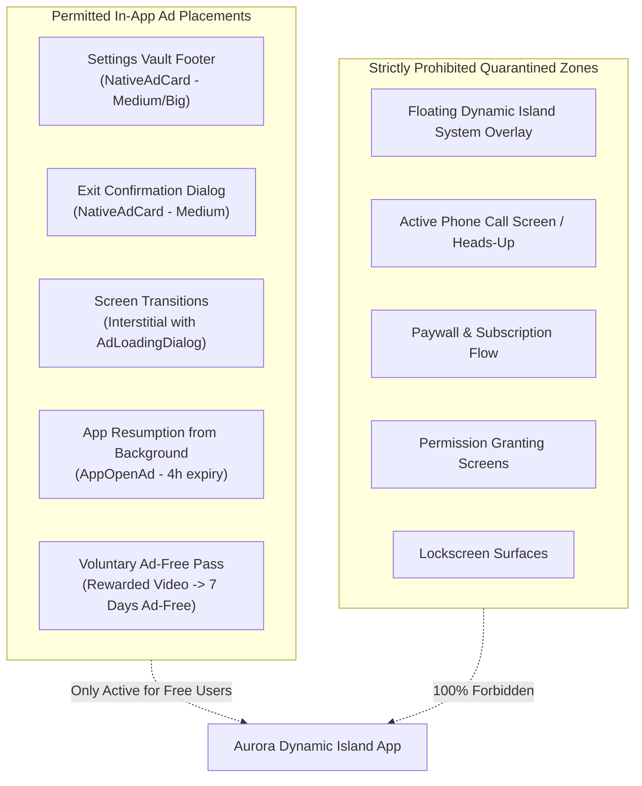

# Aurora Dynamic Island — Advertisement Placement Rules & Policy Compliance

**Version:** 2.0.0  
**Effective Date:** 17 October 2026  
**Audience:** Android UI Engineers, Product Designers, and QA Testers  
**Authority:** Mandatory Placement & Policy Standard for `ai.emots.kishan_dynamic`  

---

## 1. Core Principles

Aurora Dynamic Island adheres strictly to the **Google Play Developer Program Policies** and **Google AdMob Placement Policies**. 

Our primary monetization rule is absolute:
> **Advertisements must never interfere with the operating system, must never appear inside floating system overlays, and must never deceive or mislead the user into accidental clicks.**

---

## 2. Strict Quarantine Zones (ZERO-AD AREAS)

Under no circumstance may an advertisement be displayed in any of the following zones:

| Quarantine Zone | Technical Mechanism | Rationale |
| :--- | :--- | :--- |
| **Floating Dynamic Island Overlay** | Overlay window managed by `FloatingIslandService` has **ZERO** Google Mobile Ads dependencies. | System overlays floating above third-party applications or the Android home screen are strictly prohibited from showing ads by Google Play policy and user trust. |
| **Active Phone Call / Call Heads-Up** | `CallOverlay` suppresses all ad notifications and full-screen interstitials. | Displaying ads during ongoing telephone calls or emergency communications is unsafe and a severe violation of user trust. |
| **Paywall & Purchase Surfaces** | `IslandStateManager.isPaywallActive.value == true` blocks all ad requests and suppresses floating overlays. | Commercial surfaces must provide an unobstructed, premium conversion experience without conflicting commercial messages. |
| **Permission Onboarding Flow** | `PermissionScreen` and `OnboardingScreen` explicitly bypass ad triggers. | Users must grant essential runtime accessibility and notification permissions without being interrupted by ads. |
| **Lockscreen Overlays** | Overlays when device is locked are restricted to critical glanceable information. | AdMob strictly forbids ads on the device lockscreen. |

---

## 3. Approved Advertisement Placements

Advertisements are strictly restricted to the following sandboxed, in-app surfaces:



### 3.1 Settings Vault Footer (`SettingsVaultScreen.kt`)
- **Format:** `NativeAdCard` (`NativeAdSize.Medium` or `NativeAdSize.Big`).
- **Placement:** Placed at the bottom of the Settings Vault scrollable content, separated by `AppTheme.spacing.sectionGap` (24dp).
- **Separation:** Must never be placed immediately adjacent to clickable action items without visual demarcation. Uses `AppSurface.Card` background with clear "Ad" / "Sponsored" badge.

### 3.2 Exit Confirmation Dialog (`ExitConfirmationDialog.kt`)
- **Format:** `NativeAdCard` (`NativeAdSize.Medium`).
- **Placement:** Rendered inside the back-press exit confirmation modal, directly beneath the confirmation message.
- **Toggle:** Governed by Remote Config flag `isExitNativeEnabled`. If false or if ad fails to load, the dialog renders only the standard confirmation buttons.

### 3.3 Non-Critical Screen Navigation (Interstitial Ads)
- **Format:** `InterstitialAd` with `AdLoadingDialog`.
- **Placement:** Triggered on navigation exits from secondary utility screens (e.g. Notch Alignment Tool, Custom Island Studio).
- **Restrictions:**
  - Governed by `screenCounterForInterstitial` (default: 3 transitions) and `clickCounterForInterstitial` (default: 30 clicks).
  - Preceded by `AdLoadingDialog` with 6-second timeout to prevent sudden visual shock.
  - Never triggered during back navigation that exits the app (handled by Exit Confirmation Dialog instead).

### 3.4 Process Foreground Resume (App Open Ads)
- **Format:** `AppOpenAd`.
- **Placement:** Triggered when the user returns to Aurora Dynamic Island from the background.
- **Restrictions:**
  - **Cold Launch Exclusion:** Never shown on initial application launch (`isColdLaunch = true`).
  - **4-Hour Expiry:** Cached ads older than 4 hours are discarded.
  - **Suppressed on Permission Screen:** If user was in the middle of granting permissions, App Open is suppressed.

### 3.5 Voluntary Rewarded Pass (`MobileAdsRewardedPassGateway.kt`)
- **Format:** `RewardedAd`.
- **Placement:** Initiated exclusively by explicit user intent from the Settings Vault or Paywall ("Watch a video to get 7 days free").
- **Reward:** Unlocks 7 days of ad-free usage without purchasing a subscription.

---

## 4. UI Layout & Collapsibility Rules

### 4.1 Zero Empty Space on Load Failure (0dp Collapse)
When a native ad or banner fails to load due to network error, no fill, or ad-free entitlement:
- The composable MUST collapse to **0dp height** and **0dp margin**.
- Empty grey rectangles, blank cards, or broken placeholders are strictly prohibited.
```kotlin
if (nativeAdState == null && !isLoading) {
    Spacer(Modifier.height(0.dp))
}
```

### 4.2 Loading Shimmer Integrity
While an ad is actively loading:
- Display `NativeAdShimmer` matching the exact layout and corner radii of the target card.
- Never cause layout shifts (CLS) when transitioning from shimmer to rendered ad.

### 4.3 Native Ad View Recycling Ban
- Each `NativeAd` instance must be bound to a dedicated `NativeAdView` and destroyed when scrolled off-screen or replaced.
- Reusing detached ad views across different composables causes attribution discrepancies and AdMob policy strikes.

---

## 5. Accidental Click Prevention Standards

To prevent unintentional clicks and comply with Google AdMob accidental click policies:
1. **Minimum Spacing:** Maintain at least 16dp clearance between native ad interactive buttons and app navigation elements.
2. **Clear Attribution:** All native ads must prominently display the official "Ad" / "Sponsored" badge with high-contrast text.
3. **No Deceptive Framing:** Ad cards must never imitate core Android system dialogs, emergency notifications, or simulated download buttons.
4. **Touch Target Size:** Native CTA buttons must satisfy the standard 48dp touch target height.
